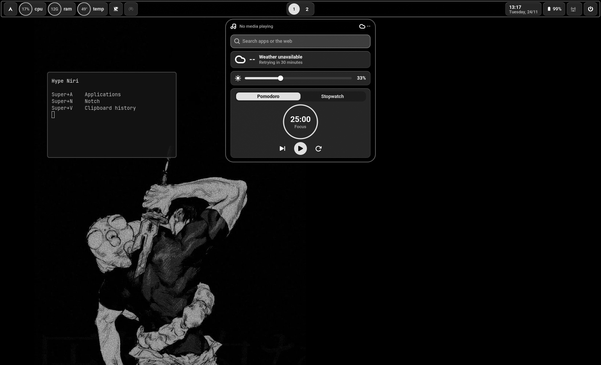
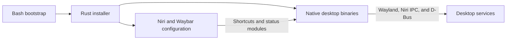

<a id="readme-top"></a>

<div align="center">

# Hype Niri

**A monochrome Arch Linux desktop with Niri scrollable tiling, Waybar, and native Rust controls.**

[](https://github.com/Dijo-404/hype_niri/releases/latest)
[](LICENSE)


[Quick start](#quick-start) · [Usage](#usage) · [Documentation](#documentation) · [Contributing](#contributing)

</div>

<br/>

<p align="center">
  
</p>

> [!NOTE]
> This guide follows `main`. See the [v1.0.0 release notes](https://github.com/Dijo-404/hype_niri/releases/tag/v1.0.0) for the original tagged setup.

## Overview

Hype Niri is a set of dotfiles and an interactive installer for a Niri desktop on Arch Linux. It brings together a consistent monochrome theme, keyboard-driven window management, and GTK4 utilities for everyday desktop tasks.

### Features

- **Navigate by keyboard.** Scroll between tiling columns, switch workspaces, and open the app launcher, emoji picker, or clipboard history.
- **Keep controls close.** Waybar shows system status. The notch provides app search, weather, media controls, a Pomodoro timer, and a stopwatch on each display.
- **Manage displays and connections.** Pick a wallpaper with previews, set monitor refresh rates, and manage a saved NetworkManager hotspot from the desktop.
- **Switch power profiles automatically.** Use Performance on AC where supported, Balanced on battery at 30% or above, and Power Saver below 30%.
- **Get the full desktop by default.** The installer includes browsers, tools, Bluetooth, and offline dictation with Hype Flow.

## Requirements

| Requirement  | Details                                                                                                     |
| :----------- | :---------------------------------------------------------------------------------------------------------- |
| **OS**       | Arch Linux with `pacman`, an interactive terminal, sudo access, and an internet connection for installation |
| **Build**    | Git, `base-devel`, Rust and Cargo 1.92 or newer                                                             |
| **Desktop**  | Niri, GTK4 4.24 or newer, `gtk4-layer-shell`, and `libpulse`                                                |
| **Optional** | `yay` when a selected, missing package comes from the AUR. Hype Flow's Parakeet worker requires x86-64.     |

See the [core package list](pkglist.txt) for the complete package set.

## Installation

Run the bootstrap from an interactive terminal as your regular user with sudo access.

```bash
curl -fsSL https://raw.githubusercontent.com/Dijo-404/hype_niri/main/install.sh | bash
```

The bootstrap builds the Rust installer locally. It offers to install missing build tools. The installer requires a full Arch upgrade before installing desktop packages and asks before backing up and replacing existing user configurations.

Press Enter or answer `y` at **Install extras?** to install every extra. Answer `n` for the core desktop, or `custom` to choose [groups](optional-packages.txt). The default install builds Hype Flow, downloads and verifies the English Parakeet model, and configures Hype Flow to start in the background at Niri login. Press `Alt+Space` to dictate with the default shortcut.

<details>
<summary><b>Install from a local checkout</b></summary>

<br/>

```bash
git clone https://github.com/Dijo-404/hype_niri.git
cd hype_niri
./install.sh
```

The [installation guide](INSTALL.md#manual-install) also covers applying individual components.

</details>

### Updating

From your local checkout, pull the latest changes and rerun the installer.

```bash
cd hype_niri
git pull --ff-only
./install.sh
```

### Uninstalling

Log out of Niri and use another session or a TTY. Restore the configurations you want to keep from the `~/.config-backup-*` directory printed by the installer. Remove any Hype Niri files that had no previous version. Review the packages and services you enabled separately. See [Dependencies and services](DEPENDENCIES.md).

## Quick start

Log in to the **Niri** session from your display manager. Then try these shortcuts.

1. Press `Super+A` to find an app. Press `Enter` to launch it.
2. Press `Super+N` to open the notch and try the timer or app search.
3. Press `Super+Shift+W` to choose a wallpaper.
4. With Hype Flow installed, press `Alt+Space` to start dictation and press it again to finish.

## Usage

### Commands

Desktop commands use the installed binaries. Run the installer help command from a checkout.

| Command                                                     | Description                                         |
| :---------------------------------------------------------- | :-------------------------------------------------- |
| `~/.config/scripts/hype-control --check`                    | Check the native desktop control binary.            |
| `~/.config/scripts/hype-control --help`                     | List desktop commands.                              |
| `~/.config/scripts/hype-control auto-power-profile --check` | Inspect the current power policy and D-Bus support. |
| `~/.config/scripts/hype-control clipboard clear`            | Clear stored clipboard history.                     |
| `~/.config/scripts/hype-notch --toggle`                     | Open or close the notch drawer.                     |
| `./install.sh --help`                                       | Show bootstrap usage from a local checkout.         |

### Keybindings

| Key                         | Action                                   |
| :-------------------------- | :--------------------------------------- |
| `Super+A`                   | Open the app launcher                    |
| `Super+T`                   | Open Alacritty                           |
| `Super+←` / `Super+→`       | Focus the adjacent tiling column         |
| `Super+1` through `Super+0` | Switch to workspaces 1 through 10        |
| `Super+N`                   | Toggle the notch drawer                  |
| `Super+V`                   | Open clipboard history                   |
| `Super+Shift+H`             | Open hotspot settings                    |
| `Super+L`                   | Lock the session                         |
| `Alt+Space`                 | Start or finish dictation with Hype Flow |
| `Super+Ctrl+Esc`            | Cancel dictation with Hype Flow          |

See the [full keybinding reference](keybindings.md).

### Examples

**Use the notch.** Hover over the pill below Waybar for a compact view and move within it to open the controls. Press `Super+N` to pin the drawer and focus search. You can also open controls from the grid button in the file shelf. Press `Esc` to close it. The drawer includes media controls, volume and brightness sliders, a 25-minute focus timer with a five-minute break, and a stopwatch. With Hype Flow installed, it also shows dictation status and controls. The speech worker loads on first use and unloads after 10 idle minutes by default.

**Hold files in the notch.** Hover over the notch and press `Ctrl+V` to paste a screenshot, or drag local files onto the pill. Either action opens the file shelf. Use the folder button beside search to reopen the shelf when it contains files. Drag one item or use **Drag all** to copy them to another app. Use the **×** on a tile to remove its cached copy. Copies in `~/.cache/hype-niri/notch-shelf/` expire after 10 minutes.

**Copy and paste in Alacritty.** Select text and press `Ctrl+C` to copy it. Press `Ctrl+V` to paste and `Ctrl+Shift+C` to interrupt a running command.

**Share a connection over Wi-Fi.** Click the hotspot icon in Waybar to toggle sharing. Right-click it or press `Super+Shift+H` for credentials and password settings. The first start creates `Hype-Niri` with a random password. It tries 5 GHz where supported, falls back to 2.4 GHz, and remembers the working band. The hotspot uses WPA2 Personal with AES/CCMP and accepts an 8–63 character ASCII password or a 64-digit hexadecimal key. Internet sharing requires an upstream connection such as Ethernet, USB tethering, or a second Wi-Fi adapter. Starting a hotspot can disconnect Wi-Fi on the selected adapter. Changing an active hotspot password restarts it.

**Pair a Bluetooth keyboard.** With the `bluetooth` group installed, open **Bluetooth Devices** from the tray and select **Pair**. If Blueman displays a passkey, type it on the Bluetooth keyboard and press `Enter`.

## Configuration

Edit `~/.config/niri/config.kdl` for keybindings and window rules, `~/.config/niri/outputs.kdl` for display settings, and `~/.config/waybar/config.jsonc` or `~/.config/waybar/style.css` for the bar. The installer preserves saved monitor settings. See the [manual configuration steps](INSTALL.md#3-copy-configurations).

A typical output block looks like this. Replace `DP-1` with the name shown by `niri msg outputs`.

```kdl
output "DP-1" {
    scale 1.25
}
```

### Environment variables

| Variable              | Effect                                                                      |
| :-------------------- | :-------------------------------------------------------------------------- |
| `WALLPAPER_DIR`       | Override the wallpaper directory used by the desktop controls.              |
| `WAYBAR_CONFIG`       | Override the config path used by `hype-control start-waybar`.               |
| `XDG_STATE_HOME`      | Override the state root used for clipboard history and the saved wallpaper. |
| `HYPE_CONTROL_BINARY` | Select the `hype-control` binary used by Python runtime tests.              |

### Files it creates

| Path                                             | Contents                                                                                         |
| :----------------------------------------------- | :----------------------------------------------------------------------------------------------- |
| `~/.config-backup-*`                             | Copies of existing configurations and shell files that the installer backs up before replacement |
| `~/.config/niri/outputs.kdl`                     | Saved display configuration                                                                      |
| `~/.config/hype-niri/optional-groups`            | Selected extras                                                                                  |
| `~/.config/scripts/`                             | Installed desktop binaries and compatibility links                                               |
| `~/.local/state/niri/current_wallpaper`          | Symlink to the selected wallpaper by default                                                     |
| `~/.local/state/hype-niri-clipboard/history.bin` | Private clipboard history by default                                                             |
| `~/.cache/hype-niri/cargo-target/`               | Reusable Cargo build artifacts                                                                   |

## Privacy and safety

- Clipboard history keeps supported text and images locally, up to 64 entries, 8 MiB per entry, and 32 MiB total. It skips selections marked as sensitive by supported clipboard hints.
- The notch requests IP-based weather from wttr.in every 30 minutes. Selecting the web search result opens the query in DuckDuckGo in your default browser.
- Hype Flow transcribes locally after the initial model download. The notch receives dictation state and microphone levels over session D-Bus. Transcript text stays with Hype Flow and the dictation output it produces.
- The installer asks before replacing backed-up configurations or applying optional changes such as a display-manager switch or firewall setup.

## How it works



`hype-control` handles desktop actions. `hype-status` streams temperature and hotspot state to Waybar. A single GTK4 layer-shell process renders the notch on each active display and follows GTK's reduced-motion setting. Cargo pins the Niri configuration decoder to Niri 26.04 and the wallpaper client protocol to awww 0.12.1.

## Tech stack

| Component                  | Tool                                                                                                                                           |
| :------------------------- | :--------------------------------------------------------------------------------------------------------------------------------------------- |
| **Compositor and bar**     | [Niri](https://github.com/YaLTeR/niri), [Waybar](https://github.com/Alexays/Waybar)                                                            |
| **Native UI**              | [Rust](https://www.rust-lang.org/), [GTK4](https://www.gtk.org/), [GTK4 Layer Shell](https://github.com/wmww/gtk4-layer-shell)                 |
| **Terminal and shell**     | [Alacritty](https://github.com/alacritty/alacritty), [Zsh](https://www.zsh.org/)                                                               |
| **Notifications and lock** | [Mako](https://github.com/emersion/mako), [Hypridle](https://github.com/hyprwm/hypridle), [Hyprlock](https://github.com/hyprwm/hyprlock)       |
| **Audio and wallpaper**    | [PipeWire](https://pipewire.org/), [WirePlumber](https://pipewire.pages.freedesktop.org/wireplumber/), [awww](https://codeberg.org/LGFae/awww) |

## Project structure

```text
.
├── install.sh             # Source-build bootstrap
├── installer/             # Rust installer and integration tests
├── native/                # Rust desktop controls, status streams, and Stealth backend
├── notch/                 # GTK4 notch and UI tests
├── niri/                  # Compositor settings and keybindings
├── waybar/                # Bar configuration, styles, and icons
├── hypr/                  # Hypridle and Hyprlock configurations
├── scripts/notch.css      # Styles embedded in the notch
├── systemd/               # Power profile and memory pressure configuration
├── tests/                 # Bootstrap and desktop regression suites
├── pkglist.txt            # Core packages
└── optional-packages.txt  # Extras enabled by default
```

## Development

```bash
git clone https://github.com/Dijo-404/hype_niri.git
cd hype_niri
sudo pacman -Syu --needed base-devel rust gtk4 gtk4-layer-shell libpulse
cargo test --workspace --locked
cargo build --workspace --bins --locked
```

Run the regression suites against the debug binaries. The runtime tests use private Bubblewrap and D-Bus fixtures and need `python-gobject`, `bubblewrap`, and `dbus`. The GUI suite creates a private headless Sway session and requires Sway and `wtype`.

```bash
/usr/bin/python3 tests/test-bootstrap.py
/usr/bin/python3 tests/test-runtime.py
/usr/bin/python3 tests/test-native-runtime.py
/usr/bin/python3 tests/test-warp-indicator.py
/usr/bin/python3 tests/test-native-media.py
/usr/bin/python3 tests/test-native-session.py
/usr/bin/python3 tests/test-native-gui.py
./target/debug/hype-control --check
./target/debug/hype-notch --check
./target/debug/hype-status --check
./target/debug/stealth version
```

Run the lint and formatting checks before submitting changes.

```bash
shellcheck install.sh
shfmt -d install.sh
cargo fmt --all --check
cargo clippy --workspace --locked --all-targets -- -D warnings
prettier --check . --ignore-unknown
ruff check tests
ruff format --check tests
```

## Troubleshooting

<details>
<summary><b>Niri validation reports a missing outputs.kdl</b></summary>

<br/>

The installer creates `outputs.kdl`. To validate a fresh checkout without installing, run this from the repository root.

```bash
touch niri/outputs.kdl
niri validate -c niri/config.kdl
```

</details>

<details>
<summary><b>Cargo cannot find gtk4-layer-shell-0</b></summary>

<br/>

Install the `gtk4-layer-shell` package, then verify that `pkg-config` can find it.

```bash
sudo pacman -Syu --needed gtk4-layer-shell
pkg-config --modversion gtk4-layer-shell-0
```

For a user-local library install, add its `lib/pkgconfig` directory to `PKG_CONFIG_PATH`.

</details>

## Documentation

| Guide                                        | What's in it                                                   |
| :------------------------------------------- | :------------------------------------------------------------- |
| [Installation](INSTALL.md)                   | Manual setup, service configuration, and troubleshooting       |
| [Keybindings](keybindings.md)                | Window management, workspace navigation, and desktop shortcuts |
| [Dependencies and services](DEPENDENCIES.md) | Core packages, optional groups, and native replacements        |
| [Zsh aliases](alias.md)                      | Shell shortcuts and optional tools                             |

## Contributing

Open an issue for bugs or feature requests. Include your Niri version, the relevant optional groups, and steps to reproduce a bug. Pull requests should include the checks you ran. [GitHub Issues](https://github.com/Dijo-404/hype_niri/issues)

## License

Released under the [MIT License](LICENSE). See the [Waybar icon credits](waybar/icons/README.md) for bundled icons.

<br/>

<div align="center">
  <sub>Built by <a href="https://github.com/Dijo-404">Dijo-404</a> · <a href="#readme-top">Back to top</a></sub>
</div>
